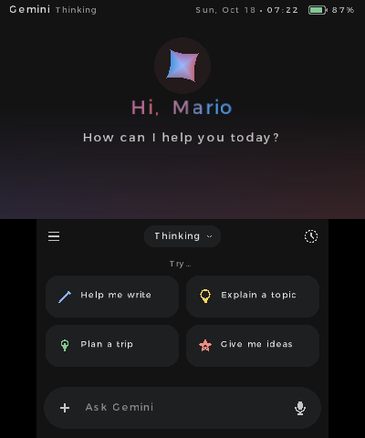
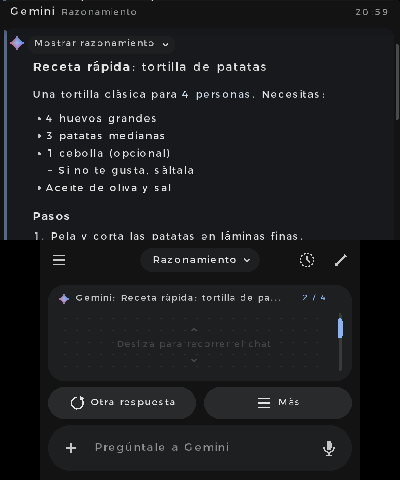
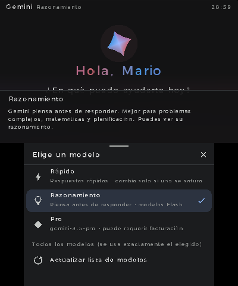
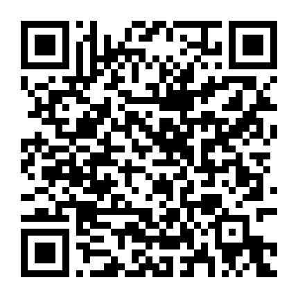

# Gemi3DS

**Gemini AI en tu Nintendo 3DS.** Un cliente homebrew de Gemini para 3DS y New 3DS, con respuestas en vivo, historial, cámara, notas de voz y vinculación por QR desde el teléfono.

*English below · [Read in English](#english)*

<p align="center">
  
  
  
</p>

## Descargar e instalar



**Instalar sin cables con FBI (recomendado)**
1. En la 3DS abre **FBI** → *Remote Install* → *Scan QR Code*.
2. Escanea el código QR de la derecha. Descarga siempre la última versión del `.cia`.
3. Gemi3DS aparece en el menú HOME.

**Instalar a mano**
- **`.cia`**: descarga `Gemi3DS.cia` de la [última versión](https://github.com/venomshine/Gemi3DS/releases/latest), cópialo a la SD e instálalo con FBI.
- **`.3dsx`**: copia `Gemi3DS.3dsx` a `sd:/3ds/` y ábrelo desde el Homebrew Launcher.
- **Emulador (Azahar/Citra)**: *Archivo → Cargar archivo…* y elige `Gemi3DS.3dsx`.

Necesitas una consola con homebrew (por ejemplo, con [3ds.hacks.guide](https://3ds.hacks.guide/)) y conexión Wi-Fi. Funciona en 3DS y 2DS, y va más fluido en New 3DS / New 2DS.

## Vincular tu cuenta (una sola vez)

Gemi3DS usa la **API oficial de Gemini** con una clave gratuita de Google AI Studio.

1. Abre la app: aparece un **código QR**. Escanéalo con el teléfono conectado a **la misma red Wi-Fi** que la consola.
2. En la página que se abre, toca **Abrir Google AI Studio**, inicia sesión con tu cuenta de Google y pulsa **Create API key**. Es gratis.
3. Pega la clave en la página, escribe tu nombre y pulsa **Conectar con mi 3DS**.

La clave se guarda solo en tu tarjeta SD (`sd:/3ds/Gemi3DS/config.json`). También puedes escribirla en la consola o crear `sd:/3ds/Gemi3DS/apikey.txt` con la clave dentro.

> **¿Por qué una clave y no iniciar sesión con Google?** Google no permite iniciar sesión en Gemini desde dispositivos como la 3DS. La clave de AI Studio es la forma oficial y gratuita de usar Gemini desde otras apps.

## Funciones

- Respuestas **en vivo**, palabra por palabra, con Markdown: títulos, negritas, listas, citas, tablas y código.
- Modos **Rápido** y **Razonamiento**: eligen solos el modelo Flash más rápido y cambian a otro gratuito si uno va lento o se satura. Modo **Pro** y lista completa de modelos, que usa exactamente el modelo que elijas.
- **Touchpad** en la pantalla táctil para recorrer la conversación.
- **Historial** en la SD con títulos automáticos, chats fijados, renombrar, borrar y **búsqueda** por título o contenido. **Chat temporal** que no se guarda.
- **Información guardada**: dile «recuerda que…» y Gemini lo tendrá en cuenta en todos tus chats. Puedes verla, editarla y borrarla.
- **Cámara**, **fotos de la SD** y **notas de voz** para preguntar sobre imágenes o hablar con Gemini.
- **Compartir por QR** una respuesta al teléfono o guardarla como `.txt`.
- Tema oscuro y claro, tres tamaños de texto.
- Idiomas: **español, inglés y japonés** (o el de la consola).

Gemi3DS no genera imágenes: la 3DS no tiene memoria, potencia ni pantalla para ello. Para eso, usa Gemini en el navegador o en el móvil.

El nivel gratuito de la API tiene límites por minuto y por día. Si se alcanzan, la app lo avisa.

## Controles

| Botón | Acción |
|---|---|
| **A** | Escribir un mensaje |
| **Y** | Nota de voz / detener la respuesta |
| **X** | Menú «Más» del mensaje resaltado |
| **↑ ↓ / L R** | Mensaje anterior / siguiente |
| **Circle Pad / ZL ZR** | Desplazar la conversación |
| **SELECT** | Menú (historial y ajustes) |
| **B** | Atrás / cerrar |
| **START** | Salir |

Todo se puede hacer también con la pantalla táctil.

## Problemas conocidos

Se corregirán en una próxima versión:

- **Sonido del menú HOME:** al seleccionar Gemi3DS en el menú de la consola suena un tono distinto al previsto, parecido a un teléfono.
- **Cámara congelada:** al abrir la cámara para hacer una foto, a veces la imagen se queda congelada en el primer fotograma tras unos segundos. La app sigue funcionando: puedes cerrar la cámara, cambiarla o hacer la foto, pero la vista previa no se actualiza. Mientras tanto, puedes hacer la foto con la cámara de la 3DS y elegirla en **+ → Fotos de la consola**.

## Errores y sugerencias

¿Algo falla o se ve raro? Abre un [issue](https://github.com/venomshine/Gemi3DS/issues) o escríbeme en [Discord](https://discord.com/invite/yVKp8JwV4e). Si quieres apoyar el proyecto: [Ko-fi](https://ko-fi.com/venomshine).

## Compilar desde el código

1. Instala [devkitPro](https://devkitpro.org/wiki/Getting_Started) con el paquete *3DS Development*.
2. Instala las librerías y compila:
   ```
   dkp-pacman -S 3ds-dev 3ds-curl 3ds-mbedtls
   make
   ```
   Se genera `Gemi3DS.3dsx`.
3. Para el `.cia`, pon [`bannertool`](https://github.com/Steveice10/bannertool) y [`makerom`](https://github.com/3DSGuy/Project_CTR) en el PATH y ejecuta `make cia`.

```
source/   código de la app
  main.c          arranque y bucle principal
  scene_login.c   vinculación por QR
  scene_chat.c    conversación, menús y herramientas
  gemini.c        API de Gemini (streaming, modelos, títulos, memoria)
  net.c           hilo de red (libcurl + mbedTLS)
  pair.c          servidor web local para vincular desde el teléfono
  md.c            maquetador de Markdown
  gfx.c ui.c icons.c   gráficos, componentes e íconos
  store.c         configuración e historial en la SD
  media.c         cámara, micrófono e imágenes
  i18n.c          idiomas (la tabla i18n_tab.h se genera con tools/gen_i18n.py)
lib/      cJSON, QR Code generator, stb_image
romfs/    página de vinculación y certificados raíz
cia/      banner, sonido y configuración del .cia
tools/    traducciones (tools/i18n_tr.py)
```

Para añadir o corregir traducciones, edita `tools/i18n_tr.py` y ejecuta `python3 tools/gen_i18n.py`.

---

## English

**Gemini AI on your Nintendo 3DS.** A homebrew Gemini client for 3DS and New 3DS with live streaming answers, chat history, camera, voice notes and QR pairing from your phone. The interface is available in Spanish, English and Japanese.

**Install:** open **FBI** → *Remote Install* → *Scan QR Code* and scan the QR above, or download `Gemi3DS.cia` / `Gemi3DS.3dsx` from the [latest release](https://github.com/venomshine/Gemi3DS/releases/latest).

**Setup:** the app shows a QR code. Scan it with your phone (same Wi-Fi network), create a free API key in Google AI Studio, paste it on the page and you're done. The key is stored only on your SD card.

**Build:** devkitPro with `3ds-dev 3ds-curl 3ds-mbedtls`, then `make` (or `make cia` with bannertool and makerom).

Known issues (to be fixed in the next version): the HOME menu banner plays the wrong sound, and the camera preview can freeze after a few seconds (use + → Console photos as a workaround).

Bugs and ideas: [issues](https://github.com/venomshine/Gemi3DS/issues) or [Discord](https://discord.com/invite/yVKp8JwV4e).

---

Hecho por **VENOMSHiNE** · [GitHub](https://github.com/venomshine) · [Discord](https://discord.com/invite/yVKp8JwV4e) · [Ko-fi](https://ko-fi.com/venomshine)

Gemi3DS es un proyecto no oficial y no está afiliado a Google. Gemini es una marca de Google LLC. *Gemi3DS is an unofficial project, not affiliated with Google.*

Licencia: [MIT](LICENSE). Incluye cJSON (MIT), QR Code generator de Project Nayuki (MIT), stb_image (dominio público / MIT) y los certificados raíz de Mozilla (MPL 2.0).
